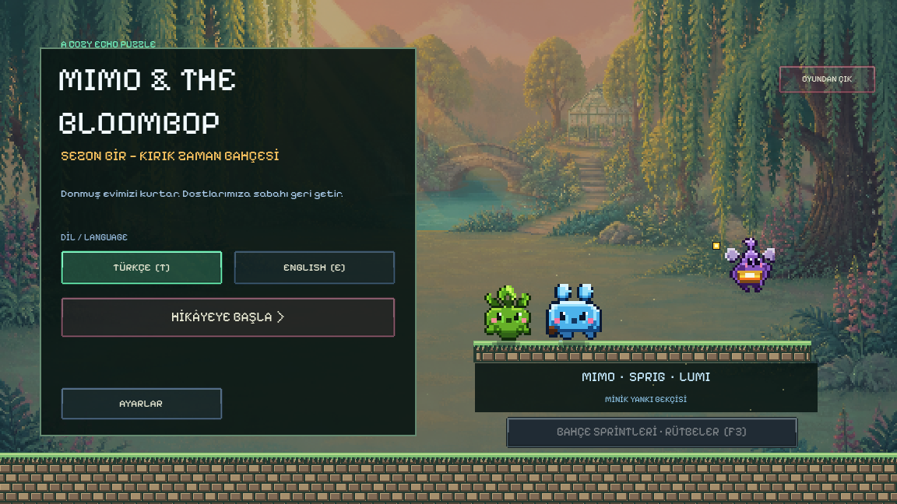
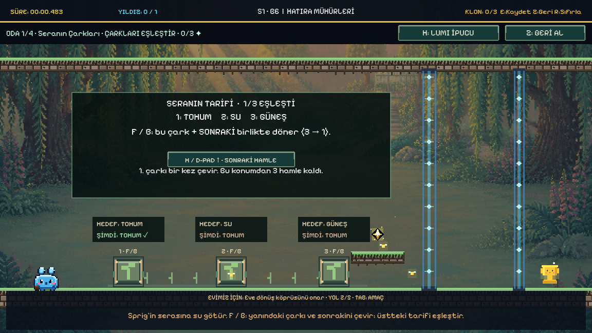
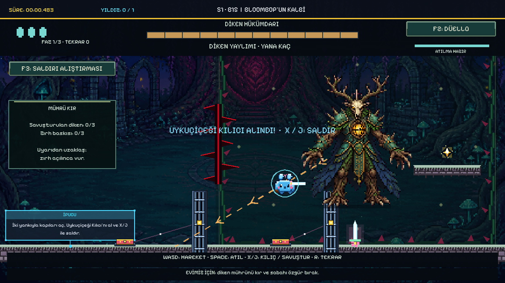

# Mimo & the Bloombop

### Record your past. Open a new path. Bring morning home.

**Windows · Single-player · English / Turkish · Keyboard and controller**

Record Mimo's movements and let the echoes operate switches and lifts to open new paths. Bring water back to Sprig's greenhouse, uncover forgotten memories, and break the Thorn Sovereign's seal.

[English](README.md) · [Türkçe](README.tr.md)

## Download and play

**[Download the Windows game ZIP](../../releases/latest/download/Mimo-and-the-Bloombop-Windows.zip)** · [All releases](../../releases) · [Gameplay showcase — MP4](../../releases/latest/download/Mimo-Showcase.mp4)

1. Download <code>Mimo-and-the-Bloombop-Windows.zip</code>.
2. Extract the entire ZIP to a folder.
3. Launch <code>Mimo-and-the-Bloombop.exe</code>. You do not need to install Godot.
4. Choose a language from the main menu. **Start Story** opens the tutorial.

GitHub's automatically generated **Source code (zip)** archive is not the game. Use the game ZIP linked above.

The build is not digitally signed, so Windows may show a warning. Keep your security software enabled. Check the file's source and the <code>SHA256SUMS.txt</code> checksum published with the release. Report a problem if Windows blocks the file.

## What to expect

- **Echoes that work together:** recorded movements operate buttons and switches.
- **Changing gardens:** puzzles with lifts, mushrooms, gravity, keys, and a greenhouse.
- **A clear goal:** help Mimo, Sprig, and Lumi bring morning back to their frozen home.
- **The Thorn Sovereign:** a three-phase fight with five attack patterns, a sword, parrying, and dashing.
- **Play at your pace:** follow the story, find optional memories, or speedrun unlocked chapters.
- **Accessibility options:** reduced motion, echo contrast, and separate audio settings.

### In-game scenes

**[Watch or download the 37-second gameplay showcase](../../releases/latest/download/Mimo-Showcase.mp4)** — edited footage recorded with game audio; includes an ending excerpt. The character was controlled with automated inputs during recording; boss damage and mechanics use the game's own systems.

## Controls

| Action | Keyboard |
| --- | --- |
| Move | A/D or arrow keys |
| Jump | Space |
| Record an echo | E |
| Nearby switch / wheel | F |
| Contextual hint | H |
| Retry the room | R |
| Pause | Esc |
| Boss: sword / parry | X or J |
| Boss: dash | Space |
| Boss: practice / pattern selection | F3 / F4 |

Controller controls are shown in-game. Boss practice does not complete the story; assisted boss mode is marked as assisted in speedruns.

## Compatibility and save data

This is a Windows x64 build and requires a Vulkan-capable graphics card and driver. An NVIDIA RTX 2060 SUPER was used on the test machine; this is not a minimum system requirement. Performance on other hardware is not guaranteed.

Progress and settings are stored locally under <code>%APPDATA%\Godot\app_userdata\Mimo &amp; the Bloombop</code>. Do not delete this folder when updating the game. See [Privacy](PRIVACY.md).

## Report a problem

Use [Issues](../../issues) to share the chapter/room number, reproduction steps, a screenshot, and your Windows and graphics-card details. Do not send passwords, access keys, or personal files.

The 15 main chapter routes and 42 inter-room layouts passed automated physics checks. This does not mean every bug has been found on every device. See [Known issues](KNOWN_ISSUES.md).

## Distribution and copyright

This repository is a **distribution and showcase page for players**. It does not include the Godot project, game scripts, or editable assets. A free download does not grant an open-source license. See the [usage notice](COPYRIGHT.md) and [credits and third-party licenses](CREDITS.md).
